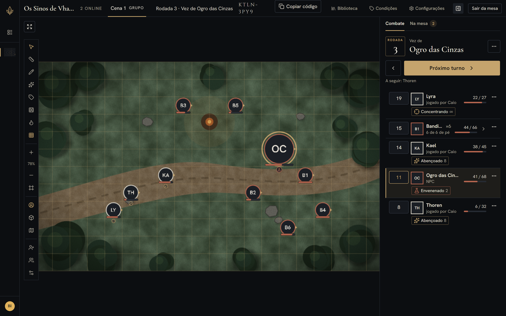
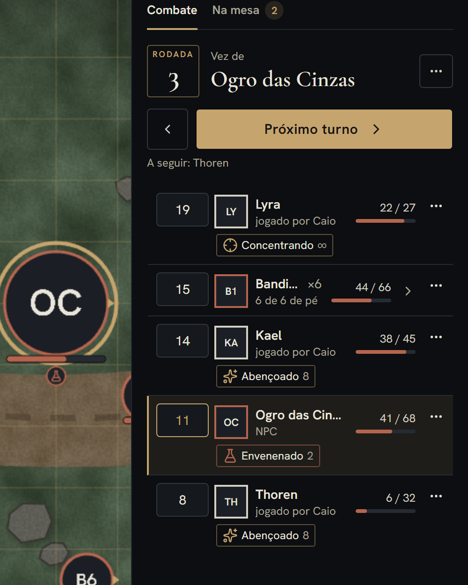
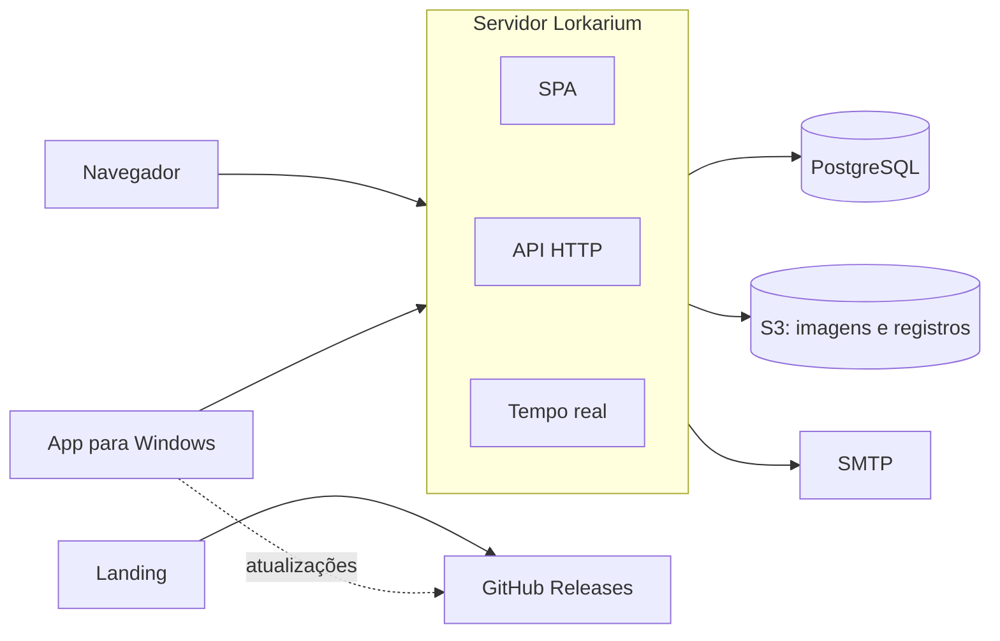

# Lorkarium

**Mesa virtual para combates de RPG de mesa.** Grid, tokens, iniciativa, barras, condições, dados 3D e chat, tudo sincronizado em tempo real com o grupo, pelo app para Windows ou pelo navegador. Funciona com qualquer sistema: D&D, Tormenta20, Ordem Paranormal ou aquele que vocês inventaram.

[**Baixar para Windows**](https://github.com/ByelBardini/lorkarium/releases/latest) · Windows 10 ou 11, 64 bits · grátis durante o acesso antecipado, com conta por convite



## Como se joga

1. **O mestre cria a mesa.** Dá um nome, escolhe o sistema e manda o código de entrada no grupo.
2. **O grupo entra.** Cada um usa a própria conta, pelo app ou pelo navegador, e entra pelo código como espectador. O mestre promove quem vai jogar.
3. **Bora jogar.** O mestre abre um grid, coloca os tokens e rola iniciativa. O resto se ajusta no caminho.

Mapas, tokens, barras, condições e a biblioteca de grids ficam salvos no servidor. Quem cai da internet recupera o estado da mesa ao voltar, até em outro computador. Mensagens do chat e resultados dos dados têm histórico local durante a visita à mesa; quem chega depois começa com esse histórico vazio.

## Recursos

### Tabuleiro

- Grids em abas, cada um com a sua imagem de fundo, e câmera com zoom e arraste.
- Tokens que andam casa por casa, régua com distância e três camadas: tokens, objetos e fundo.
- Desenhos e formas com cor, áreas de efeito com as casas atingidas pintadas e ping no mapa com o nome e a cor de quem marcou.
- Copiar e colar (Ctrl+C/V), desfazer e refazer (Ctrl+Z/Y).
- **Biblioteca de grids:** prepare os mapas antes, organize em pastas, deixe privado até a hora da surpresa e leve o grupo para lá com um clique.

### Tokens

- Imagem ou iniciais, borda quadrada ou redonda, de meia casa a 10 casas, virado para qualquer direção.
- **Até 8 barras por token** (PV, mana, escudo, sanidade…), com cor, número ou porcentagem e quem pode ver os valores. Dano e cura direto na barra: `−7` tira, `+5` soma.
- O mestre decide quais jogadores controlam cada token, e cada jogador tem o seu token principal à mão.
- Tokens invisíveis para os jogadores, marca de abatido e um elenco de personagens que leva o mesmo estado para qualquer grid.
- **Até 8 formas por token:** formas nomeadas com imagem, borda e tamanho próprios para representar transformações, mantendo barras, condições e controle.
- Auras com cor, efeito animado ou imagem, com alcance e opacidade configuráveis.

### Combate e condições



- Ordem de iniciativa, contador de rodadas e um botão para passar a vez. Inimigos iguais entram numa linha só.
- Condições da mesa com nome, ícone, cor, gravidade, descrição e stacks. A mesa já nasce com uma lista pronta (Abençoado, Envenenado, Atordoado e outras) e o mestre edita como quiser.
- **Condições que contam sozinhas:** envenenado por 2 rodadas? O Lorkarium desconta no fim do turno e avisa quando acaba. Invisível e inconsciente mudam a aparência do token no mapa.

### Visão, luz e paredes

- Cada token enxerga até onde alcança, em luz plena e na penumbra, com névoa sobre o resto e campo de visão em cone.
- Luzes no mapa e nos tokens: alcance, cor, feixe de lanterna, acesas ou apagadas. Tochas acompanham quem as carrega.
- Paredes bloqueiam a visão e a passagem; portas abrem, fecham e trancam na hora certa.
- O mestre vê o mapa inteiro e pode olhar a cena pelos olhos de qualquer token.

### Mesa e grupo

- Dono da mesa, co-mestres, jogadores e espectadores, com permissões próprias e presença ao vivo.
- Ficha da mesa por membro: nome do personagem, CA, CD e anotações.
- Perfil com apelido, cor, bio e foto.
- Configurações da mesa, capa e exclusão.

### Dados

- **Dados 3D com física no servidor:** d4, d6, d8, d10, d12, d20 e d100. A face em que o dado para determina o resultado; quem pode ver a rolagem acompanha o mesmo lançamento. Até 20 modelos por rolagem, com os demais dados sorteados no servidor.
- Fórmulas como `1d20+5`, vantagem e desvantagem, manter ou descartar dados, explosões, rerrolagens e contagem de sucessos. Dados personalizados de 2 a 1000 faces.
- Rolagens públicas ou só para os mestres e quem rolou, salvas por mesa e histórico com os resultados de cada dado. A rolagem secreta mostra apenas um aviso a quem não pode vê-la.
- Aparência, som e exibição dos dados 3D configuráveis na conta.

### Chat

- Conversa da mesa, sussurros, privados e grupos. Espectadores também conversam; os mestres só recebem as conversas das quais participam.
- Fale como um token que controla, com balão no tabuleiro; o mestre pode falar como qualquer token da cena.
- Comandos `/r` para rolar, `/gr` para rolar só para os mestres e `/w` para sussurrar, além de atalhos para as rolagens salvas.
- **Chat e Dados em janelas separadas**, abertas ao mesmo tempo enquanto você usa o tabuleiro. No app para Windows, elas podem ficar sempre por cima.

### Conta e segurança

- Acesso por convite: quem recebe escolhe o próprio @ e a senha.
- Login em duas etapas, verificação em duas etapas por aplicativo autenticador, lista de sessões ativas, troca de senha e de e-mail e avisos de segurança por e-mail.
- E-mail cifrado no banco e registros de acesso guardados conforme o Marco Civil da Internet.
- Painel de administração das contas: papel, suspensão, exclusão, convites e link de nova senha.

### App para Windows

- Instalador que não pede administrador e usa o WebView2 que já vem no Windows.
- Atualiza sozinho e fica na bandeja do sistema.
- Mesma conta e mesmas mesas do navegador: no Mac e no Linux, joga-se pelo navegador.

## Como funciona

O servidor é a autoridade sobre a mesa: o cliente pede cada ação, o servidor confere a permissão, aplica e salva as mudanças persistentes antes de avisar o grupo. Chat, dados e pings são eventos efêmeros, sem gravação no servidor. O estado compartilhado que aparece na tela é confirmado pelo servidor, e cada um recebe só o que pode ver: barras restritas e tokens ocultos são enviados apenas a quem tem permissão, assim como as conversas e rolagens privadas.



- **Um processo, uma origem:** a mesma imagem Docker serve a SPA, a API e o Socket.IO, e migra o banco ao subir.
- **Regra de jogo separada da tela:** distância, turnos, condições, visão e luz moram num pacote de TypeScript puro, usado igual pelo servidor e pelo cliente.
- **Independente de sistema:** barras, condições e iniciativa são genéricas e configuráveis por mesa.
- **Segurança desde a base:** autenticação, autorização, validação de toda entrada e isolamento entre mesas.
- **Simples de operar:** monólito modular numa instância só, numa VPS.

## Stack

| Camada    | Tecnologias                                                                                                                                       |
| --------- | ------------------------------------------------------------------------------------------------------------------------------------------------- |
| Frontend  | React 19, TypeScript, Vite 8, PixiJS 8, three.js, Zustand 5, Tailwind CSS v4, shadcn/ui, React Router 8, Socket.IO Client 4, Zod 4                |
| Backend   | Node.js 26, TypeScript, Fastify 5, Socket.IO 4, Zod 4, PostgreSQL 17, Drizzle ORM, Pino, AWS SDK (S3), sharp, nodemailer, otpauth, cannon-es      |
| Desktop   | Tauri 2 + Rust, instalador NSIS; splash em TypeScript puro + Vite                                                                                 |
| Landing   | Astro 7 estático, Tailwind CSS v4, servido por Caddy                                                                                              |
| Qualidade | Vitest 5, Playwright, Testing Library, ESLint 10, Prettier 3, TypeScript 6 strict, Husky + lint-staged                                            |
| Infra     | Docker (imagem multi-estágio), Docker Compose (Postgres, SeaweedFS, Mailpit), Coolify, VPS Linux, AWS S3, SMTP, GitHub Actions + semantic-release |

## Estrutura do repositório

```text
lorkarium/
├── client/                 # SPA (React + Vite); PixiJS em src/renderer/, three.js em src/dice-renderer/
├── server/                 # API e tempo real (Fastify + Socket.IO + Drizzle); módulos em src/modules/
├── site/                   # Landing (Astro): apresentação, download do instalador, Termos e Privacidade
├── desktop/                # App para Windows (Tauri 2): splash em src/, Rust e instalador em src-tauri/
├── packages/
│   ├── game-core/          # Regra de jogo pura: células, distância, turnos, condições, visão, luz
│   ├── contracts/          # DTOs Zod que atravessam client ↔ server (HTTP e Socket.IO)
│   ├── brand/              # Paleta, fontes e logo
│   └── tsconfig/           # Configurações TypeScript compartilhadas
├── e2e/                    # Testes ponta a ponta com Playwright
├── infra/
│   ├── compose/            # Postgres, SeaweedFS (S3) e Mailpit do ambiente local
│   └── docker/             # Smoke da imagem de produção
├── docs/context/           # Documentação técnica, uma área por arquivo
├── .github/                # CI, release do desktop e Dependabot
├── Dockerfile              # Imagem de produção
└── pnpm-workspace.yaml
```

Os pacotes internos (`@lorkarium/game-core`, `@lorkarium/contracts`) são consumidos direto pelo código-fonte TypeScript, sem build próprio; o build do server os coloca dentro do bundle.

## Desenvolvimento

### Pré-requisitos

- Node.js >= 26.13.0 (versão de referência em `.nvmrc`) e pnpm 11.9.0 (fixado no `package.json`)
- Docker Desktop aberto (Postgres, SeaweedFS e Mailpit locais)
- Só para o app desktop: Rust estável >= 1.90 e o MSVC Build Tools (C++)

### Primeiros passos

O Node.js 26 não inclui o Corepack. Para instalar a versão de pnpm usada pelo projeto:

```bash
npm install --global pnpm@11.9.0
```

```bash
pnpm install
cp server/.env.example server/.env
```

Antes de subir, preencha `ADMIN_EMAIL` e `ADMIN_PASSWORD` no `server/.env` para criar a conta de administração no primeiro boot; o server só a cria se o e-mail ainda não existir. Os demais valores de desenvolvimento do `.env.example` já funcionam.

```bash
pnpm dev
```

O `pnpm dev` sobe Postgres, SeaweedFS e Mailpit, espera os healthchecks, aplica as migrações e roda client e server juntos.

- App: http://localhost:5173
- API: http://localhost:3333/api (o Vite encaminha `/api` para ela)
- Caixa de e-mail do Mailpit: http://localhost:8025

Para testar a mesa com mais gente, `pnpm db:seed-dev` cria as contas Bia (`@bia`) e Caio (`@caio`), com a senha `lorkarium-dev`. Ao entrar numa mesa pelo código, elas começam como espectadoras e podem ser promovidas a jogadoras pelo mestre.

A landing roda à parte, com `cp site/.env.example site/.env` e `pnpm site:dev` (http://localhost:4321). O app desktop abre sobre o `pnpm dev` com `pnpm desktop:dev`.

### Scripts

Executados na raiz do repositório:

| Script                  | Descrição                                                                         |
| ----------------------- | --------------------------------------------------------------------------------- |
| `pnpm dev`              | Sobe a infra local, aplica as migrações e roda client e server                    |
| `pnpm build`            | Gera o build de todos os pacotes que têm build                                    |
| `pnpm typecheck`        | Verifica tipos em todo o workspace (specs incluídos)                              |
| `pnpm lint`             | Executa o ESLint                                                                  |
| `pnpm format`           | Formata o código com Prettier                                                     |
| `pnpm format:check`     | Verifica a formatação sem alterar arquivos                                        |
| `pnpm test`             | Testes (Vitest) de todos os projetos, sem a integração                            |
| `pnpm test:packages`    | Testes de game-core, contracts e da splash do desktop, com cobertura              |
| `pnpm test:client`      | Testes do client, com cobertura                                                   |
| `pnpm test:server`      | Testes unitários do server, com cobertura                                         |
| `pnpm test:integration` | Testes de integração do server (exige Postgres)                                   |
| `pnpm e2e:install`      | Baixa o Chromium do Playwright                                                    |
| `pnpm test:e2e`         | Testes ponta a ponta (sobe server e client próprios; pare o `pnpm dev`)           |
| `pnpm test:e2e:site`    | Testes ponta a ponta da landing                                                   |
| `pnpm bench`            | Benchmarks do tabuleiro, da visão e da física dos dados (fora dos testes e do CI) |
| `pnpm db:up`            | Sobe Postgres, SeaweedFS e Mailpit via Docker Compose                             |
| `pnpm db:down`          | Derruba os containers locais                                                      |
| `pnpm db:generate`      | Gera o SQL de migração a partir das tabelas                                       |
| `pnpm db:migrate`       | Aplica as migrações no `DATABASE_URL`                                             |
| `pnpm db:seed-dev`      | Cria os jogadores de teste Bia e Caio (recusa em produção)                        |
| `pnpm db:seed-stress`   | Cria a "Mesa de estresse" da Bia no tamanho do bench (recusa em produção)         |
| `pnpm mail:preview`     | Envia um exemplar de cada e-mail do sistema ao Mailpit                            |
| `pnpm site:dev`         | Roda a landing em http://localhost:4321                                           |
| `pnpm site:build`       | Gera a landing estática em `site/dist/`                                           |
| `pnpm desktop:dev`      | Abre a janela do app desktop sobre o `pnpm dev`                                   |
| `pnpm desktop:build`    | Gera o instalador NSIS do app desktop                                             |

Para rodar um script num pacote específico: `pnpm --filter @lorkarium/client <script>`. Um spec só: `pnpm exec vitest run <caminho>`.

Componentes do shadcn/ui são adicionados a partir de `client/`:

```bash
cd client && pnpm dlx shadcn@latest add button
```

### Testes

Cada workspace guarda seus specs em `<workspace>/test/`, espelhando `src/`. A regra de jogo e os DTOs são testados em unit puro; no server, a regra de negócio e os casos de uso em unit, e as bordas, as consultas, as permissões e o isolamento entre mesas em integração com Postgres real. O client tem specs de componente com Testing Library. Os testes Rust rodam com `cargo test` em `desktop/src-tauri/`.

O e2e roda no Chromium com banco de sufixo `_e2e` e bucket de sufixo `-e2e`, sem tocar nos de desenvolvimento. Mantenha a infra de `pnpm db:up` ligada e configure o admin no `server/.env`; o Playwright sobe seu próprio server e client. Localmente, prefira `pnpm test:e2e --workers=1`. A preparação da integração e os detalhes do e2e estão em [docs/context/ci.md](docs/context/ci.md) e [docs/context/ci/e2e.md](docs/context/ci/e2e.md).

Antes de abrir um PR: `pnpm test && pnpm lint && pnpm typecheck`. O CI roda as mesmas camadas, o e2e por grupos e o build com smoke da imagem Docker.

## Publicação

- **Servidor:** Coolify numa VPS, Postgres 17 gerenciado pelo Coolify, imagens e registros de acesso em buckets S3 da AWS e e-mail por SMTP. Cada push na `main` gera um deploy. O passo a passo, com todas as variáveis de ambiente, está em [docs/context/deploy.md](docs/context/deploy.md).
- **App para Windows:** commits convencionais relevantes em `desktop/` na `main` geram uma release no GitHub, que a landing oferece para download e o app instalado recebe como atualização. Detalhes em [docs/context/desktop.md](docs/context/desktop.md).
- **Landing:** site estático numa imagem Caddy, ver [docs/context/site.md](docs/context/site.md).

## Contribuindo

- [AGENTS.md](AGENTS.md): stack, layout, camadas do server (PO, DAO, BO, DTO, VO) e o índice da documentação por área.
- [CLAUDE.md](CLAUDE.md): estilo de código, testes e regras para quem trabalha no repositório, gente ou agente de IA.
- [docs/context/](docs/context/): o detalhe de cada área (contratos, eventos, tabelas, armadilhas). É a fonte da verdade de quem mexe no código e acompanha cada mudança.

Commits seguem o padrão convencional (`feat`, `fix`, `docs`…), em português.
